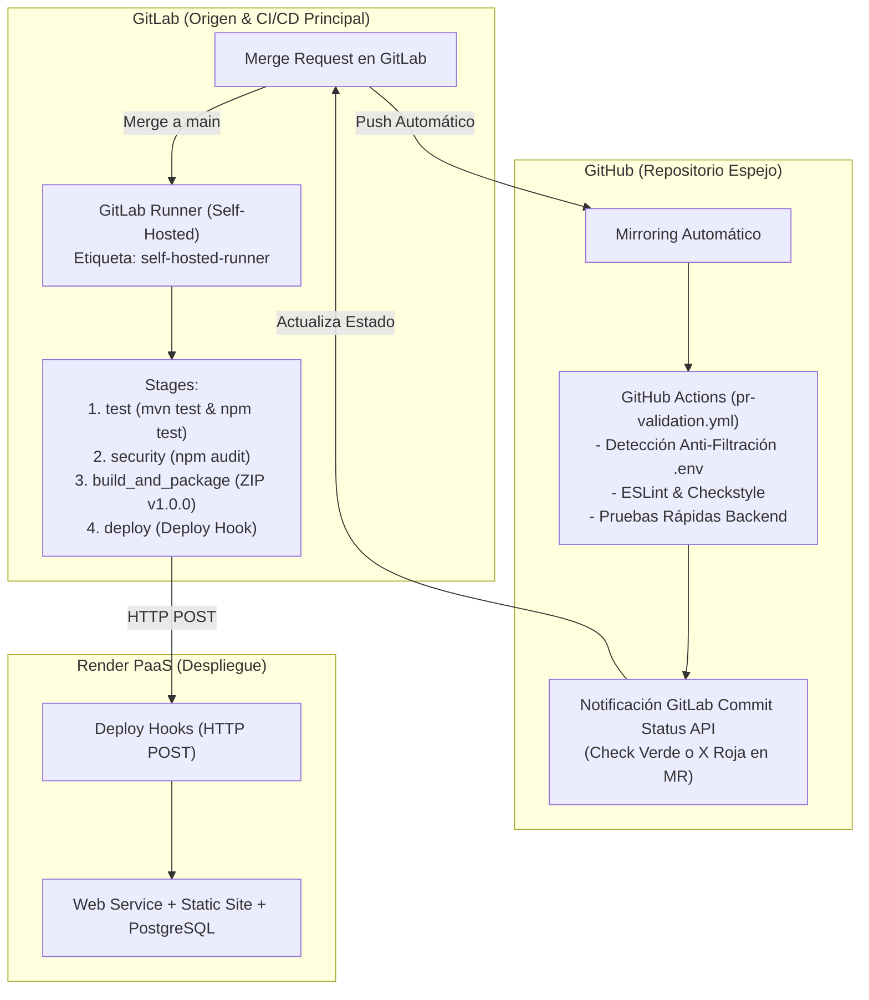

# IT Incident Hub - Plataforma Integral de Gestión de Incidentes de TI

[](https://www.oracle.com/java/)
[](https://spring.io/projects/spring-boot)
[](https://react.dev/)
[](https://vitejs.dev/)
[](https://www.postgresql.org/)
[](https://render.com)
[](https://gitlab.com)
[](https://github.com)

---

## 📌 1. Descripción del Proyecto y Arquitectura DevOps

**IT Incident Hub** es una plataforma web para la gestión integral de incidentes de soporte tecnológico alineada a las mejores prácticas de **ITIL v4**. La solución permite el levantamiento, categorización, asignación técnica, control estricto de transiciones de estado, bitácora de resoluciones y analítica operacional en tiempo real.

### Flujo DevOps End-to-End Actualizado:
1. **Centro de Operaciones (GitLab):** Es el repositorio de trabajo principal donde se crean las ramas (`feature/*`, `fix/*`), se gestionan las tareas en los tableros y se abren los **Merge Requests**.
2. **CI/CD Principal (GitLab CI/CD en Runner Self-Hosted):** Cada commit en ramas y Merge Requests ejecuta el pipeline [.gitlab-ci.yml](file:///c:/Users/50254/Documents/Analisis2/ProyectoFinal/ProyectoFinalAnalisis/incident-hub/.gitlab-ci.yml) en un **GitLab Runner Self-Hosted en Windows** (`tags: [self-hosted, shell]`), corriendo diagnósticos (`.pre`), pruebas unitarias e integradas (`mvn test` con JUnit 5 + Mockito y `npm test` con Vitest), análisis de código (Checkstyle y ESLint), auditoría de seguridad (`npm audit`), y compilando artefactos de entrega desacoplados e independientes para backend (`~55 KB`) y frontend (`~74 KB`).
3. **Despliegue Continuo (Render PaaS):** Tras aprobarse el Merge Request y fusionarse en `main`, el job `deploy:render_production` en el runner autohospedado dispara el despliegue automático hacia Render mediante **Deploy Hooks** HTTPS autenticados para el Backend (Docker) y Frontend (Static Site CDN).
4. **Sincronización Automática por Mirroring (GitHub):** GitLab sincroniza automáticamente cada commit y la rama `main` hacia el repositorio espejo en GitHub.
5. **Publicación Oficial de Release (GitHub Actions):** Al recibir la sincronización del merge en `main`, GitHub Actions ejecuta el workflow [.github/workflows/release.yml](file:///c:/Users/50254/Documents/Analisis2/ProyectoFinal/ProyectoFinalAnalisis/incident-hub/.github/workflows/release.yml), compilando y publicando de forma oficial el Release con notas de versión autogeneradas y paquetes `.zip` descargables adjuntos.
6. **Seguridad Estricta de Secretos:** **PROHIBIDO subir archivos `.env` a Git**. Las credenciales se inyectan en tiempo de ejecución en GitLab CI/CD Variables (`Masked` + `Protected`), GitHub Secrets y en el Dashboard de Render.


### Comandos para Alternar Identidad en Git Local:
```bash
# Carlos Gómez (DevOps / Backend)
git config user.name "Carlos Gomez"
git config user.email "carlos.gomez.devops@incidenthub.io"

# Sofía Herrera (Frontend)
git config user.name "Sofia Herrera"
git config user.email "sofia.herrera.frontend@incidenthub.io"

# Mateo Ruiz (QA / Reliability)
git config user.name "Mateo Ruiz"
git config user.email "mateo.ruiz.qa@incidenthub.io"
```

---

## 🏗️ 3. Estructura del Repositorio

```text
incident-hub/
├── .github/
│   └── workflows/
│       └── release.yml             # Publicación oficial de Releases en GitHub con artefactos .zip
├── .gitlab/
│   └── merge_request_templates/    # Plantillas de revisión de código para Merge Requests
├── backend/                        # API REST Spring Boot 3 (Java 17 + Maven)
│   ├── src/main/java/              # Controladores, Servicios, DTOs y Repositorios
│   ├── src/test/java/              # Pruebas unitarias e integradas (JUnit 5 + Mockito)
│   ├── checkstyle.xml              # Linter estático Java
│   ├── pom.xml                     # Maven POM y dependencias
│   └── Dockerfile                  # Empaquetado Multi-Stage para Render
├── frontend/                       # Aplicación SPA React 18 + Vite
│   ├── src/                        # Componentes UI, Tablero Kanban, Servicios API
│   ├── .eslintrc.cjs               # Configuración de ESLint
│   ├── package.json                # Dependencias Node.js y scripts
│   ├── vite.config.js              # Configuración de Vite y Vitest
│   └── Dockerfile                  # Contenedor Nginx para producción
├── database/                       # Scripts SQL de inicialización
│   ├── 01_init.sql                 # Esquema de tablas, índices y restricciones
│   └── 02_seed.sql                 # Datos de prueba para desarrollo
├── devops/                         # Infraestructura como Código y Configuración DevOps
│   ├── distribution/               # Plantillas y scripts de distribución independiente (backend/frontend)
│   ├── docker/
│   │   └── docker-compose.yml      # Entorno de pruebas y desarrollo local
│   ├── render/
│   │   └── render.yaml             # Blueprint IaC para despliegue en Render PaaS
│   └── runner.md                   # Guía de instalación y registro de GitLab Runner
├── docs/                           # Documentación Integral del Sistema
│   └── documentacion-sistema.md    # Documento técnico consolidado (Arquitectura, DevOps, Deuda Técnica, Seguridad)
├── .env.example                    # Plantilla de variables de entorno (sin credenciales)
├── .gitignore                      # Bloqueo estricto de secretos, .env y binarios
├── .gitlab-ci.yml                  # Pipeline principal de GitLab CI/CD (Self-Hosted Runner)
├── CHANGELOG.md                    # Historial de versiones y notas de entrega
└── README.md                       # Documentación principal del repositorio
```

---

## 🚀 4. Guía de Ejecución en Entorno Local

> [!IMPORTANT]
> **REGLA DE ORO DE SEGURIDAD:** Nunca comittees archivos `.env` a Git. Para desarrollo local, copia `.env.example` a `.env` en tu equipo y añade los valores locales correspondientes.

### Opción A: Ejecución con Docker Compose (Recomendada)
Para levantar PostgreSQL 15, el Backend Spring Boot y el Frontend React en contenedores:

```bash
# 1. Posicionarse en la carpeta devops/docker
cd devops/docker

# 2. Iniciar los servicios en segundo plano
docker compose up -d --build

# 3. Comprobar el estado y healthchecks
docker compose ps
```
- **Frontend Web:** `http://localhost:3000`
- **Backend API:** `http://localhost:8080/api/v1/incidents`
- **Healthcheck Backend:** `http://localhost:8080/api/v1/actuator/health`
- **PostgreSQL:** `localhost:5432` (Usuario: `incident_user`, BD: `incident_hub_db`)

### Opción B: Ejecución Manual para Desarrollo Activo
```bash
# 1. Base de Datos PostgreSQL
docker run --name local-postgres -e POSTGRES_DB=incident_hub_db -e POSTGRES_USER=incident_user -e POSTGRES_PASSWORD=incident_pass -p 5432:5432 -d postgres:15-alpine

# 2. Backend Spring Boot (Java 17)
cd backend
mvn clean spring-boot:run -Dspring-boot.run.arguments="--DB_URL=jdbc:postgresql://localhost:5432/incident_hub_db --DB_USERNAME=incident_user --DB_PASSWORD=incident_pass"

# 3. Frontend React (Vite)
cd frontend
npm install
npm run dev
```

---

## ⚙️ 5. Configuración del Pipeline de CI/CD



### 1. Instalación y Registro del GitLab Runner Autohospedado
Para instalar y registrar el runner en Windows o Linux, consulta la guía detallada paso a paso en [devops/runner.md](devops/runner.md).
El runner debe registrarse con los tags requeridos por el pipeline (`self-hosted`, `shell` o `docker`).

### 2. Variables Secretas Requeridas en GitLab CI/CD
Configuradas en **Settings &rarr; CI/CD &rarr; Variables** con atributos `Masked` y `Protected`:
- `RENDER_DEPLOY_HOOK_BACKEND`: URL del Deploy Hook del Backend en Render.
- `RENDER_DEPLOY_HOOK_FRONTEND`: URL del Deploy Hook del Frontend en Render (opcional).

### 3. Secretos Requeridos en GitHub Actions
Configurados en **Repository Settings &rarr; Secrets and variables &rarr; Actions**:
- `GITLAB_TOKEN`: Personal Access Token de GitLab con permisos `api` (para reportar el estado al MR).
- `GITLAB_PROJECT_ID`: ID numérico del proyecto en GitLab.

---

## ☁️ 6. Configuración de Secretos y Servicios en Render

La infraestructura en Render se aprovisiona mediante el blueprint [devops/render/render.yaml](file:///c:/Users/50254/Documents/Analisis2/ProyectoFinal/ProyectoFinalAnalisis/incident-hub/devops/render/render.yaml):

1. **Base de Datos (`incident-hub-db`):**
   - Servicio gestionado PostgreSQL 15. La URL de conexión se inyecta dinámicamente mediante `fromDatabase`.
2. **Backend Web Service (`incident-hub-backend`):**
   - Variables de entorno en Dashboard:
     - `SPRING_PROFILES_ACTIVE`: `prod`
     - `SERVER_PORT`: `8080`
     - `CORS_ALLOWED_ORIGINS`: Dominio del frontend en Render (ej. `https://incident-hub-frontend.onrender.com`).
   - Copiar la URL del **Deploy Hook** y guardarla en GitLab como `RENDER_DEPLOY_HOOK_BACKEND`.
3. **Frontend Static Site (`incident-hub-frontend`):**
   - Variable de entorno en Dashboard:
     - `VITE_API_URL`: URL del Backend en Render (ej. `https://incident-hub-backend.onrender.com/api/v1`).
   - Copiar el **Deploy Hook** y guardarlo en GitLab como `RENDER_DEPLOY_HOOK_FRONTEND`.

---

## 🧪 7. Comandos de Pruebas y Linters Locales

```bash
# Validar linter de Backend (Checkstyle)
cd backend && mvn checkstyle:check

# Ejecutar pruebas unitarias de Backend (JUnit 5 + Mockito)
cd backend && mvn test

# Validar linter de Frontend (ESLint)
cd frontend && npm run lint

# Ejecutar pruebas unitarias de Frontend (Vitest)
cd frontend && npm run test
```

---

## 📄 8. Documentación Detallada de Ingeniería

Toda la documentación técnica del sistema, arquitectura, flujo DevOps y gestión de deuda técnica ha sido unificada y actualizada en un único documento maestro dentro de `/docs`:
- [docs/documentacion-sistema.md](file:///c:/Users/50254/Documents/Analisis2/ProyectoFinal/ProyectoFinalAnalisis/incident-hub/docs/documentacion-sistema.md): Documento técnico integral que consolida:
  1. Visión general, propósito del sistema y alineación ITIL v4.
  2. Arquitectura de software, diagramas Mermaid y topología en Render PaaS.
  3. Modelo de datos entidad-relación y diccionario de tablas.
  4. Especificación completa de contratos y endpoints API REST (`/api/v1`).
  5. Tabla de equivalencias frente a Azure DevOps.
  6. Limitaciones operativas y mitigaciones en Render Free Tier.
  7. Flujo DevOps end-to-end (push &rarr; runner self-hosted &rarr; builds independientes &rarr; CD Render &rarr; Mirroring &rarr; GitHub Release).
  8. **Registro y plan de gestión de deuda técnica** (matriz de 5 deudas reales actualizadas: DT-01 a DT-05).
  9. Seguridad DevSecOps, auditoría de vulnerabilidades CVEs y política Cero Secretos.
  10. Estrategia de Branching (GitFlow adaptado), commits convencionales, procedimientos de rollback y checklist de lanzamiento.
