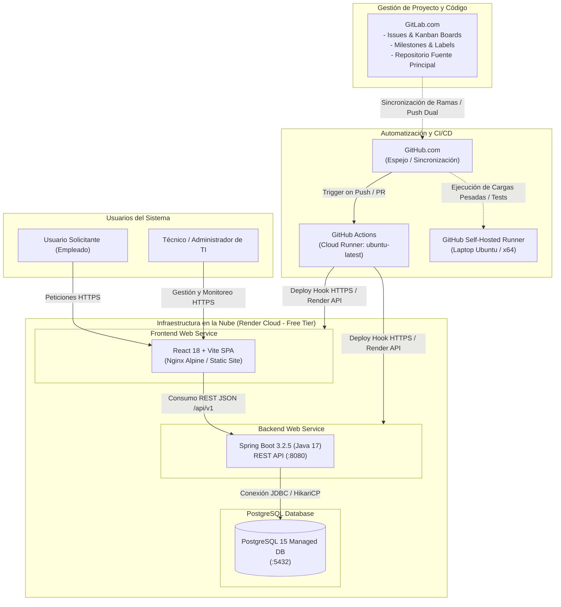
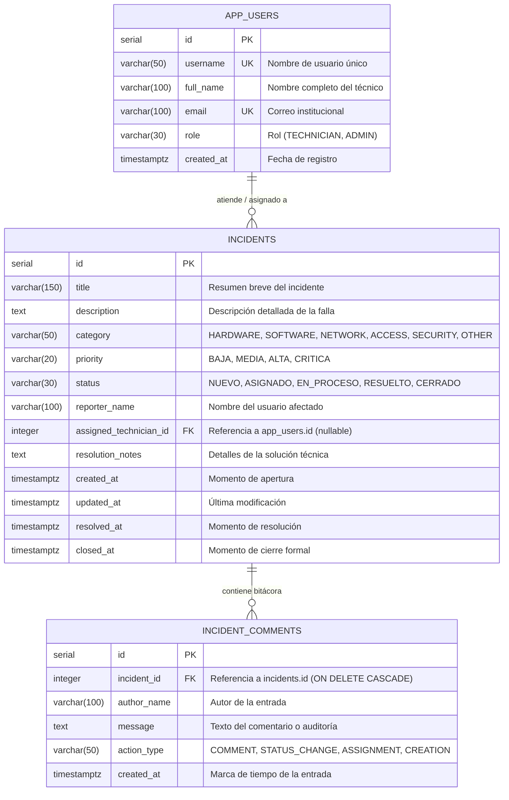

# Arquitectura del Sistema - IT Incident Hub

## Introducción

El presente documento describe la arquitectura técnica, de infraestructura y de ciclo de vida DevOps de **IT Incident Hub**. Esta solución ha sido concebida para reemplazar los canales informales y dispersos (llamadas, correos electrónicos y chats) en la gestión de incidentes del departamento de soporte de TI, proporcionando un flujo centralizado, trazable y basado en estándares ITIL.

A continuación, se detallan los componentes del sistema, el diagrama de interacciones en tiempo de ejecución y despliegue, el modelo entidad-relación, la especificación de contratos de la API REST, la matriz de equivalencias frente al requerimiento original y las consideraciones operativas derivadas del uso de servicios en nube en capa gratuita.

---

## Tabla de Contenido

1. [Diagrama de Arquitectura Global](#1-diagrama-de-arquitectura-global)
2. [Descripción y Justificación de Componentes](#2-descripción-y-justificación-de-componentes)
   - 2.1. [Capa de Presentación (Frontend SPA)](#21-capa-de-presentación-frontend-spa)
   - 2.2. [Capa de Negocio y Servicios (Backend API REST)](#22-capa-de-negocio-y-servicios-backend-api-rest)
   - 2.3. [Capa de Persistencia (Base de Datos Relacional)](#23-capa-de-persistencia-base-de-datos-relacional)
   - 2.4. [Contenerización y Portabilidad](#24-contenerización-y-portabilidad)
   - 2.5. [Gestión de Código y Backlog (GitLab)](#25-gestión-de-código-y-backlog-gitlab)
   - 2.6. [Integración y Despliegue Continuo (GitHub Actions)](#26-integración-y-despliegue-continuo-github-actions)
   - 2.7. [Agente Autohospedado (Self-Hosted Runner)](#27-agente-autohospedado-self-hosted-runner)
   - 2.8. [Plataforma de Despliegue (Render Cloud)](#28-plataforma-de-despliegue-render-cloud)
3. [Modelo de Datos Inicial](#3-modelo-de-datos-inicial)
   - 3.1. [Diagrama Entidad-Relación (Mermaid)](#31-diagrama-entidad-relación-mermaid)
   - 3.2. [Diccionario de Tablas e Integridad](#32-diccionario-de-tablas-e-integridad)
4. [Endpoints Principales de la API REST](#4-endpoints-principales-de-la-api-rest)
5. [Tabla de Equivalencias Tecnológicas](#5-tabla-de-equivalencias-tecnológicas)
6. [Limitaciones y Mitigaciones en el Plan Gratuito de Render](#6-limitaciones-y-mitigaciones-en-el-plan-gratuito-de-render)

---

## 1. Diagrama de Arquitectura Global

El sistema opera bajo una arquitectura desacoplada cliente-servidor (SPA + Stateless REST API), acompañada de una cadena de suministro de software automatizada mediante sincronización de repositorios y pipelines de CI/CD.

---

## 2. Descripción y Justificación de Componentes

### 2.1. Capa de Presentación (Frontend SPA)
- **Tecnología:** React 18, Vite 5.2, Vanilla CSS estructurado con Design Tokens HSL.
- **Justificación:** Vite ofrece un entorno de compilación ultra rápido basado en módulos ES nativos (ESM), reduciendo drásticamente los tiempos de build en los pipelines de CI/CD. Se eligió una arquitectura SPA (*Single Page Application*) para brindar una experiencia de usuario interactiva y fluida, evitando recargas de página al aplicar filtros dinámicos y actualizar el estado de las incidencias en el tablero operativo.

### 2.2. Capa de Negocio y Servicios (Backend API REST)
- **Tecnología:** Java 17 LTS, Spring Boot 3.2.5, Spring Data JPA, Hibernate, Bean Validation (Jakarta).
- **Justificación:** Spring Boot provee un ecosistema maduro, fuertemente tipado y de nivel empresarial. La utilización de Java 17 asegura soporte a largo plazo y rendimiento optimizado. Spring Data JPA abstrae las operaciones transaccionales mediante repositorios seguros, y Jakarta Bean Validation garantiza la consistencia de los datos entrantes antes de alcanzar la capa de persistencia.

### 2.3. Capa de Persistencia (Base de Datos Relacional)
- **Tecnología:** PostgreSQL 15.
- **Justificación:** Al tratarse de un sistema de soporte y auditoría donde los cambios de estado (ITIL) y los registros de comentarios no admiten inconsistencias, PostgreSQL asegura cumplimiento estricto de propiedades ACID, integridad referencial y soporte nativo de tipos temporales con zona horaria (*timestamptz*).

### 2.4. Contenerización y Portabilidad
- **Tecnología:** Docker, Docker Compose (multi-stage builds).
- **Justificación:** Garantiza la paridad absoluta entre los entornos de desarrollo local, pruebas automatizadas en runners y producción. El uso de compilación multi-etapa (*multi-stage*) permite empaquetar únicamente los binarios optimizados (JAR en Eclipse Temurin JRE y bundle estático sobre Nginx Alpine), reduciendo la superficie de ataque y el peso de las imágenes a menos de 150 MB.

### 2.5. Gestión de Código y Backlog (GitLab)
- **Tecnología:** GitLab.com (Issues, Boards, Milestones, Labels).
- **Justificación:** GitLab concentra la gobernanza del proyecto académico y la planificación ágil. En este diseño, GitLab funge exclusivamente como repositorio maestro de código fuente y tablero de gestión de tareas/tickets, mientras que la ejecución de pipelines ha sido delegada a GitHub Actions.

### 2.6. Integración y Despliegue Continuo (GitHub Actions)
- **Tecnología:** GitHub Actions Workflows (`.github/workflows/ci.yml`).
- **Justificación:** GitHub Actions provee una plataforma de integración continua moderna y flexible. Los workflows orquestan en paralelo la compilación, linters (Checkstyle y ESLint), pruebas unitarias (JUnit 5, Mockito, Vitest) y empaquetado de artefactos.

### 2.7. Agente Autohospedado (Self-Hosted Runner)
- **Tecnología:** GitHub Actions Self-Hosted Runner sobre sistema operativo Ubuntu Linux [COMPLETAR: detallar si es Ubuntu 22.04 LTS nativo o WSL2 sobre laptop personal].
- **Justificación:** Permite ejecutar jobs del pipeline consumiendo recursos locales sin consumir la cuota limitada de minutos gratuitos de GitHub Actions, además de permitir la simulación de despliegues internos de red y pruebas controladas con Docker local.

### 2.8. Plataforma de Despliegue (Render Cloud)
- **Tecnología:** Render Cloud Platform (Free Tier: Web Services para Backend y Frontend, Managed PostgreSQL).
- **Justificación:** Render facilita el alojamiento en la nube con soporte nativo de Docker y repositorios Git, aprovisionamiento automático de certificados SSL/TLS y endpoints públicos HTTPS sin costo de infraestructura para el estudiante.

---

## 3. Modelo de Datos Inicial

El modelo de datos almacena los incidentes, los usuarios técnicos asignables y la bitácora transaccional de comentarios y auditoría.

### 3.1. Diagrama Entidad-Relación (Mermaid)

### 3.2. Diccionario de Tablas e Integridad
- **`app_users`:** Almacena a los miembros del equipo técnico y administradores disponibles para resolver incidentes. Cuenta con llaves únicas en `username` y `email`.
- **`incidents`:** Núcleo de la plataforma. La llave foránea `assigned_technician_id` posee regla `ON DELETE SET NULL` para preservar el historial del ticket si un usuario técnico es dado de baja. Los índices sobre `status`, `priority`, `category` y `assigned_technician_id` garantizan filtrados a alta velocidad.
- **`incident_comments`:** Registra tanto comentarios manuales de los técnicos como eventos del sistema generados automáticamente al cambiar de estado o reasignar responsabilidades (`action_type`). Posee regla `ON DELETE CASCADE` vinculada a la tabla padre.

---

## 4. Endpoints Principales de la API REST

Todos los endpoints exponen contratos bajo el formato estándar JSON y operan bajo el prefijo base `/api/v1` (en producción enrutado directamente o mediante proxy).

| Método HTTP | Endpoint | Descripción Funcional | Parámetros / Request Body | Código Respuesta |
| :--- | :--- | :--- | :--- | :--- |
| `POST` | `/api/v1/incidents` | Registra un nuevo incidente en el sistema en estado `NUEVO`. Genera entrada inicial en bitácora. | **JSON Body:** `title`, `description`, `category`, `priority`, `reporterName`. | `201 Created` |
| `GET` | `/api/v1/incidents` | Obtiene el listado de incidentes con filtros opcionales de búsqueda combinada. | **Query Params:** `status`, `priority`, `category`, `technicianId`. | `200 OK` |
| `GET` | `/api/v1/incidents/{id}` | Retorna el detalle completo de un incidente específico por su identificador único. | **Path Variable:** `id` (Long). | `200 OK` / `404 Not Found` |
| `PATCH` | `/api/v1/incidents/{id}/status` | Transiciona el estado del incidente aplicando las reglas de ciclo de vida ITIL. | **JSON Body:** `status`, `resolutionNotes` (obligatorio si pasa a `RESUELTO`), `authorName`. | `200 OK` / `400 Bad Request` |
| `PATCH` | `/api/v1/incidents/{id}/assign` | Asigna o reasigna un técnico responsable al incidente y actualiza su estado. | **JSON Body:** `technicianId`, `authorName`. | `200 OK` / `404 Not Found` |
| `POST` | `/api/v1/incidents/{id}/comments` | Agrega un nuevo comentario a la bitácora de seguimiento del incidente. | **JSON Body:** `authorName`, `message`. | `201 Created` |
| `GET` | `/api/v1/incidents/{id}/comments` | Consulta la cronología completa de comentarios y auditoría del incidente. | **Path Variable:** `id` (Long). | `200 OK` |
| `POST` | `/api/v1/auth/login` | Autentica credenciales (usuario/correo y contraseña) contra la base de datos PostgreSQL. | **JSON Body:** `usernameOrEmail`, `password`. | `200 OK` / `401 Unauthorized` |
| `GET` | `/api/v1/auth/verify/{id}` | Valida la vigencia de la sesión activa del usuario contra la base de datos. | **Path Variable:** `id` (Long). | `200 OK` / `401 Unauthorized` |
| `GET` | `/api/v1/dashboard/stats` | Entrega métricas globales (rol ADMIN): totales, abiertos, cerrados, críticos y balance de técnicos. | *Ninguno.* | `200 OK` |
| `GET` | `/api/v1/dashboard/stats/technician/{id}` | Entrega métricas personales (rol TECHNICIAN): tickets asignados, pendientes propios, tasa individual. | **Path Variable:** `id` (Long). | `200 OK` |
| `GET` | `/api/v1/users` | Lista el catálogo de usuarios técnicos disponibles para asignación. | *Ninguno.* | `200 OK` |
| `GET` | `/api/v1/actuator/health` | Endpoint de diagnóstico para *health checks* de orquestación y Render. | *Ninguno.* | `200 OK` |

---

## 5. Tabla de Equivalencias Tecnológicas

Para dar estricto cumplimiento a los requisitos académicos del enunciado original mediante herramientas modernas de código abierto y servicios interoperables, se adoptó la siguiente matriz de equivalencias debidamente documentada:

| Requisito Original (Azure DevOps) | Stack Implementado en IT Incident Hub | Justificación Técnica de Equivalencia |
| :--- | :--- | :--- |
| **Azure Boards** | **GitLab Issues Boards** | Organización visual ágil mediante tableros Kanban, etiquetas de prioridad/tipo, hitos (*Milestones*) y estimaciones de entrega. |
| **Azure Repos** | **GitLab** | Control de versiones distribuido basado en Git, políticas de ramas protegidas y plantillas de revisión de código. |
| **Azure Pipelines** | **GitHub Actions** | Automatización declarativa en YAML de integración continua con jobs matriciales, paralelismo y Quality Gates estrictos. |
| **Self-Hosted Agent (Azure)** | **GitHub Actions Self-Hosted Runner** | Agente de compilación local registrado bajo GitHub Actions en máquina del desarrollador para optimizar tiempos y cuotas. |
| **Secretos Protegidos (Azure Key Vault / Pipeline Secrets)** | **GitHub Actions Secrets & Render Environment Variables** | Cifrado en reposo y en tránsito de credenciales, inyección en tiempo de ejecución sin exposición en código fuente ni logs. |
| **Artefactos (Azure Artifacts)** | **GitHub Actions Artifacts & Imágenes Docker** | Almacenamiento seguro de binarios JAR (`incident-hub-backend-jar`), bundle frontend compilado (`dist/`) y reportes Surefire. |
| **Release Management (Azure Pipelines Releases)** | **GitHub Releases + SemVer + Render Deploy Hooks** | Control formal de versiones con etiquetas SemVer (ej. `v1.0.0`), changelog automatizado y despliegue continuo vía Webhooks HTTPS. |

---

## 6. Limitaciones y Mitigaciones en el Plan Gratuito de Render

El entorno de producción se encuentra desplegado sobre el plan gratuito (*Free Tier*) de Render. Para fines de evaluación docente y uso continuo, deben tenerse en cuenta las siguientes restricciones arquitectónicas y sus respectivas estrategias de mitigación implementadas:

| Restricción del Free Tier | Impacto Operativo | Estrategia de Mitigación Implementada |
| :--- | :--- | :--- |
| **Suspensión por Inactividad (*Spin-Down*)** | Los servicios web entran en reposo si no reciben tráfico durante 15 minutos consecutivos. La primera petición subsiguiente experimenta un retardo (*cold start*) de 45 a 60 segundos. | 1. Implementación de pantalla con indicador visual de carga (*spinner*) en React mientras el backend responde. 2. Endpoint liviano `/api/v1/actuator/health` para verificaciones rápidas. 3. [COMPLETAR: detallar si se utiliza un servicio de ping externo como UptimeRobot o cron job para mantener despierto el servicio durante la evaluación]. |
| **Recursos de CPU y Memoria Limitados (512 MB RAM / 0.1 vCPU)** | Riesgo de finalización forzada por *Out Of Memory* (OOM Killer) si la máquina virtual de Java sobrepasa la memoria asignada. | 1. Configuración de parámetros de la JVM en el Dockerfile: `-XX:+UseSerialGC -Xmx384m -XX:MaxRAMPercentage=75.0`. 2. Empaquetado estático del frontend servido mediante Nginx ultra ligero (~20 MB RAM). |
| **Expiración de Base de Datos PostgreSQL (30 días de ciclo de vida)** | Las instancias PostgreSQL gratuitas en Render se desactivan automáticamente a los 30 días de su creación. | 1. Versionado estricto de scripts DDL (`database/01_init.sql`) y datos muestra DML (`database/02_seed.sql`) en el repositorio. 2. Automatización de carga inicial mediante scripts idempotentes para recrear el esquema en menos de 2 minutos ante una renovación de instancia. |
| **Límite de Ancho de Banda y Horas de Build Mensuales** | Agotamiento prematuro de minutos de compilación en los servidores de Render si se compila dentro de la plataforma. | Desacoplamiento de la compilación: GitHub Actions compila, ejecuta pruebas y empaqueta. Render únicamente recibe la orden de despliegue directo de los binarios probados. |

---

> **Nota para el evaluador:** Esta arquitectura garantiza el aislamiento de responsabilidades, la reproducibilidad total mediante Docker y la trazabilidad integral de cada commit desde el issue de origen en GitLab hasta la publicación en la nube.
