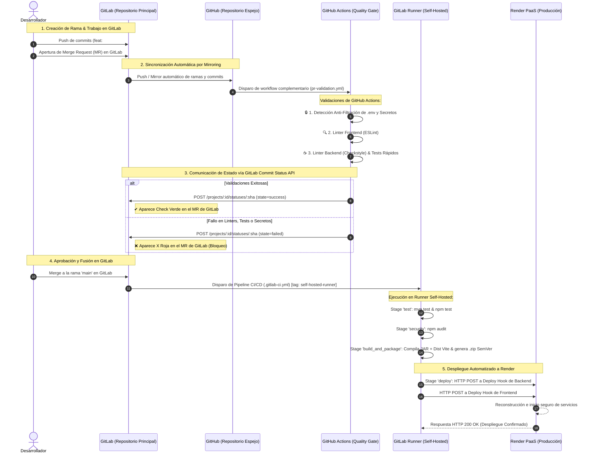
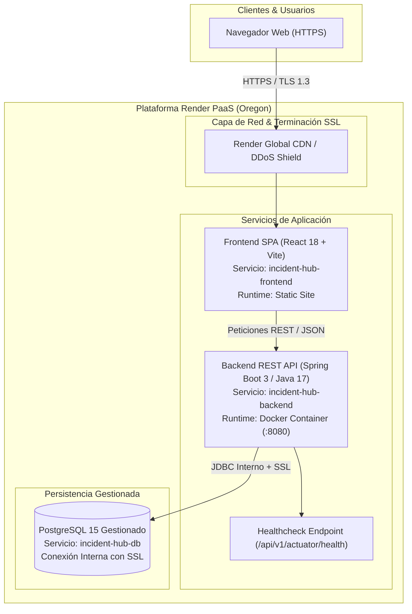
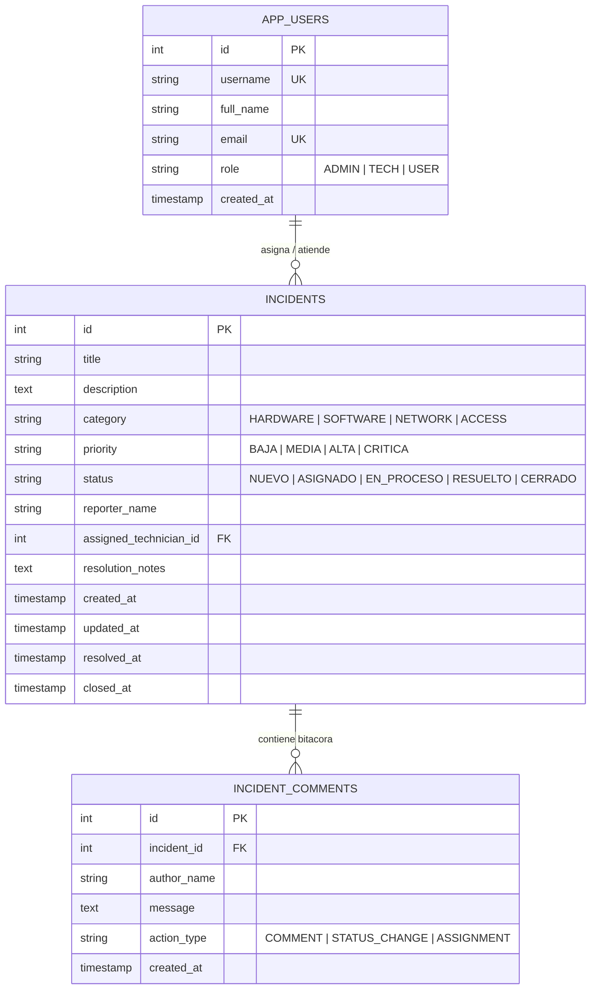
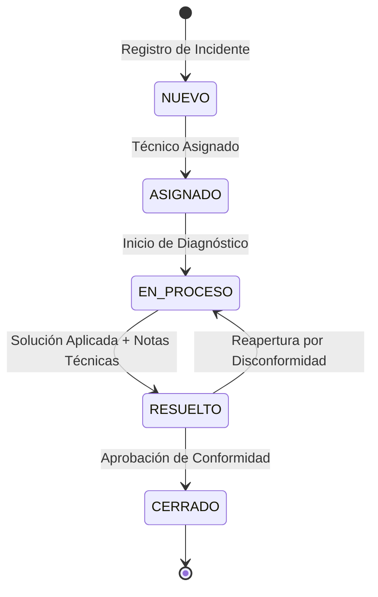

# Arquitectura del Sistema y Flujo DevOps Integral - IT Incident Hub

## 1. Visión General de la Solución

**IT Incident Hub** es una plataforma web corporativa diseñada para la gestión integral del ciclo de vida de incidentes de soporte tecnológico, siguiendo las directrices de **ITIL v4**. Su arquitectura técnica y operacional se fundamenta en un ecosistema DevOps desacoplado que integra **GitLab** como repositorio principal, sincronización por **Mirroring hacia GitHub** para validaciones complementarias, ejecución de pipelines en un **GitLab Runner Self-Hosted** y despliegue continuo hacia la nube en **Render PaaS** mediante **Deploy Hooks** seguros.

---

## 2. Diagrama de Flujo DevOps y Sincronización Real

El siguiente diagrama detalla la interacción paso a paso entre el desarrollador, GitLab (repositorio origen), GitHub (repositorio espejo), el runner autohospedado y Render:

---

## 3. Diagrama de Infraestructura en la Nube (Render PaaS)

---

## 4. Descripción de Roles y Componentes del Stack

| Capa / Componente | Plataforma / Tecnología | Rol y Responsabilidad Operacional |
| :--- | :--- | :--- |
| **Repositorio Origen** | GitLab (Cloud / Self-Hosted) | Gestión de Issues, Tableros Kanban, ramas, Merge Requests, revisiones de código y pipeline CI/CD principal. |
| **Repositorio Espejo** | GitHub (Mirroring) | Repositorio réplica sincronizado por GitLab. Alberga GitHub Actions para análisis de calidad complementario sin impactar los runners principales. |
| **Runner de CI/CD** | GitLab Runner (Self-Hosted) | Servidor local/dedicado con tag `self-hosted-runner` y executor `docker`. Compila binarios pesados de Java y empaqueta artefactos de versión. |
| **Backend REST API** | Java 17, Spring Boot 3.2.5, Maven | Arquitectura desacoplada en capas (Controller, Service, Repository, DTO), Bean Validation (JSR-380) y telemetría con Spring Boot Actuator. |
| **Frontend SPA** | React 18, Vite 5, Vanilla CSS | Single Page Application moderna con diseño responsivo, tablero interactivo y gestión de estados de incidentes. |
| **Base de Datos** | PostgreSQL 15 (Render Managed) | Almacén relacional con cumplimiento ACID, aislamiento en red privada interna y copias de seguridad continuas. |
| **CD / Despliegue** | Render Deploy Hooks | Endpoint HTTP POST seguro que dispara el despliegue automático de nuevos contenedores sin necesidad de exponer credenciales SSH. |

---

## 5. Modelo de Dominio y Entidad-Relación

---

## 6. Ciclo de Vida ITIL del Incidente (Máquina de Estados)

