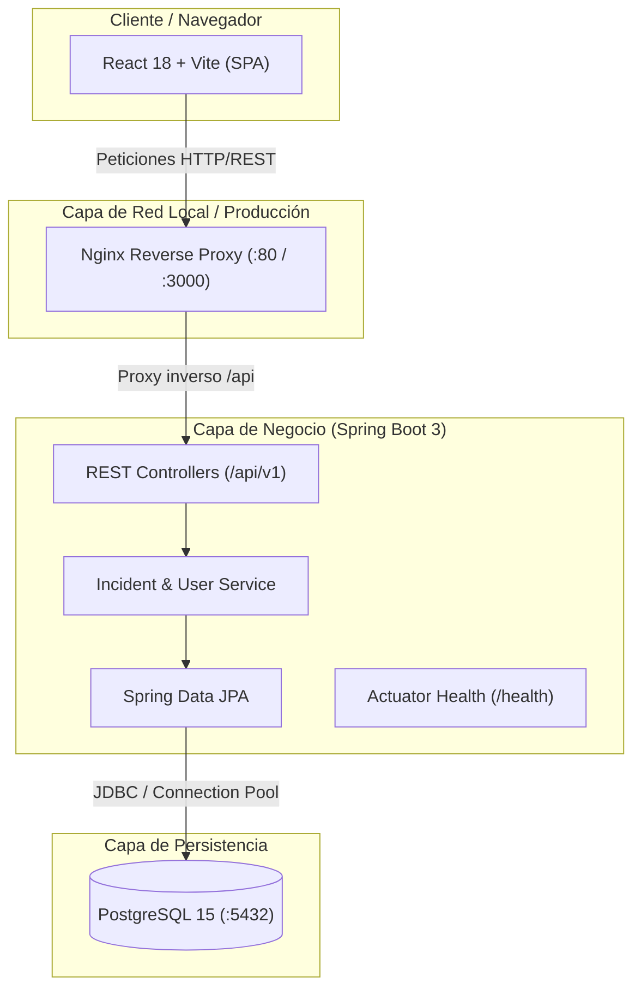
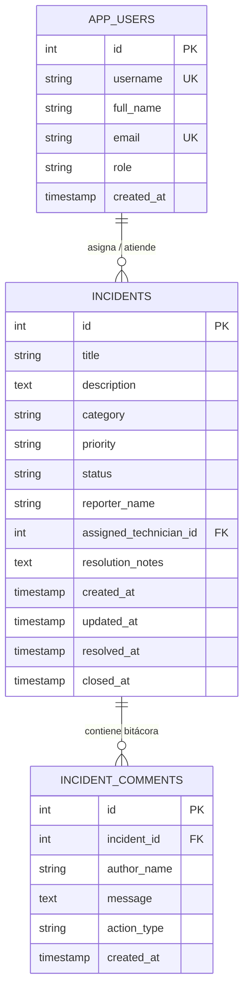
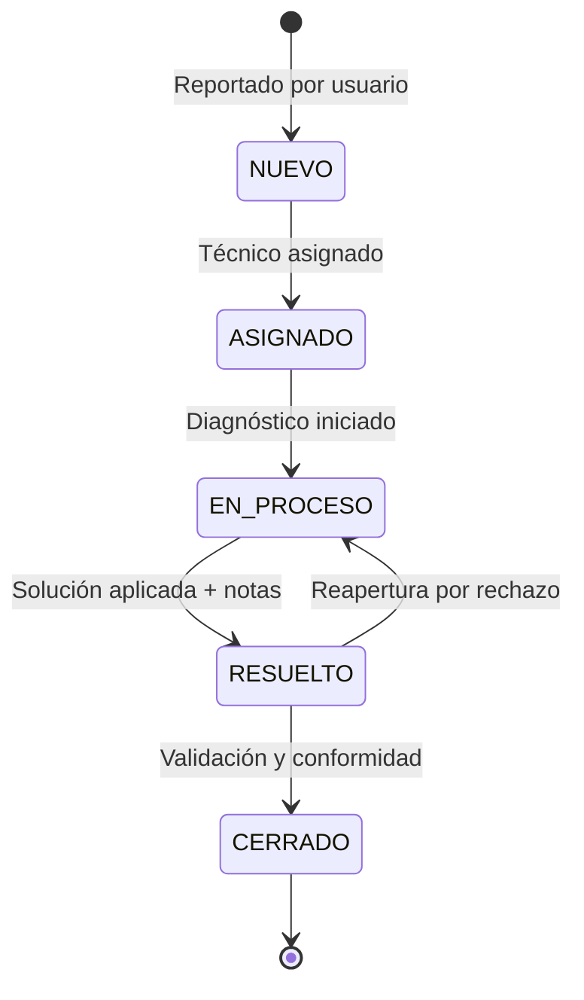

# Arquitectura del Sistema - IT Incident Hub

## 1. Visión General
**IT Incident Hub** es una plataforma web para la gestión integral del ciclo de vida de incidentes tecnológicos, diseñada bajo principios de arquitectura limpia, desacoplamiento y trazabilidad DevOps continua. Permite el registro de incidentes, asignación a personal técnico, transiciones de estado ITIL, auditoría mediante bitácora y monitoreo analítico en tiempo real.

---

## 2. Diagrama de Arquitectura de la Solución

---

## 3. Modelo de Dominio y Entidad-Relación

---

## 4. Ciclo de Vida del Incidente (Máquina de Estados ITIL)

---

## 5. Decisiones de Diseño Técnico

| Componente | Elección Tecnológica | Justificación |
| :--- | :--- | :--- |
| **Backend** | Java 17 + Spring Boot 3.2.5 | Rendimiento de clase empresarial, soporte a largo plazo (LTS), ecosistema Spring Data y Bean Validation para robustez de contratos API. |
| **Frontend** | React 18 + Vite | Rendimiento óptimo en renderizado, tiempo de carga ultrarrápido en desarrollo con HMR nativo de ESModules. |
| **Estilos** | Vanilla CSS con Tokens HSL | Máximo control estético, sin dependencias pesadas, modo oscuro nativo con efectos de desenfoque (*glassmorphism*). |
| **Persistencia** | PostgreSQL 15 | Cumplimiento ACID estricto, soporte de índices relacionales y extensibilidad para auditoría transaccional. |
| **Contenedores**| Docker Multi-Stage | Empaquetado reproducible en dos etapas que reduce el tamaño final de la imagen y minimiza vectores de ataque en tiempo de ejecución. |
