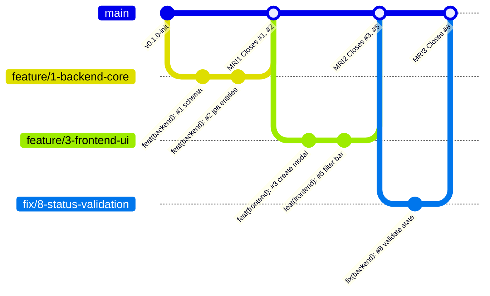

# Estrategia de Ramas, Versionado de Código y Trazabilidad

## 1. Modelo de Ramas (Git Branching Model)
El proyecto utiliza una estrategia basada en **Trunk-Based Development** asistido por ramas de corta duración (*Short-Lived Feature Branches*) y ramas de corrección controlada.



### Reglas de las Ramas:
1. **`main` (Protegida):**
   - Siempre estable y lista para despliegue.
   - No se permiten commits directos (`git push origin main` bloqueado).
   - Solo recibe código mediante **Merge Requests (MR)** aprobados y tras pasar el pipeline de CI/CD.
2. **`feature/<id>-<descripcion-corta>`:**
   - Creada desde `main` para implementar nuevas capacidades.
   - Tiempo de vida recomendado: menor a 2-3 días.
3. **`fix/<id>-<descripcion-corta>`:**
   - Creada desde `main` para resolver bugs o incidencias detectadas en CI o staging.
4. **`refactor/<id>-<descripcion-corta>`:**
   - Creada desde `main` para optimizaciones o resolución de deuda técnica sin cambiar el comportamiento externo.

---

## 2. Convención de Commits (Conventional Commits + Trazabilidad)
Cada commit debe cumplir el formato estricto:
```text
<tipo>(<alcance>): #<ID_ISSUE> <descripción imperativa en presente>

[Cuerpo opcional detallando el motivo del cambio]

[Pie opcional: Closes #<ID_ISSUE>]
```

### Tipos Permitidos:
- `feat`: Nueva funcionalidad.
- `fix`: Corrección de bug.
- `refactor`: Refactorización de código sin alterar funcionalidad.
- `test`: Incorporación o mejora de pruebas unitarias o de integración.
- `docs`: Modificaciones únicamente en documentación Markdown.
- `ci`: Cambios en la configuración de GitLab CI/CD o GitHub Actions.
- `chore`: Tareas de mantenimiento general, dependencias o configuración.

### Ejemplos Reales Válidos:
```bash
git commit -m "feat(backend): #1 crear esquema DDL inicial de PostgreSQL en database/01_init.sql"
git commit -m "feat(frontend): #3 construir componente IncidentCreateModal con validación"
git commit -m "fix(backend): #8 evitar transiciones a mismo estado lanzando BadRequestException"
git commit -m "test(backend): #16 añadir suite de pruebas unitarias IncidentServiceTest"
git commit -m "ci(gitlab): #18 configurar stages de calidad y tags para runner self-hosted"
```

---

## 3. Planificación de 6 Merge Requests (MR) Reales

Para cumplir con la simulación del equipo y la trazabilidad exigida, se planifican los siguientes 6 Merge Requests reales:

| MR # | Título del Merge Request | Rama Origen | Autor | Revisor | Issues Relacionados | Resultado / Cierre |
| :--- | :--- | :--- | :--- | :--- | :--- | :--- |
| **MR!1** | `feat: persistencia de datos y API REST de incidentes` | `feature/1-backend-core` | Carlos Gómez | Mateo Ruiz | Closes #1, Closes #2, Closes #4 | Entidad JPA, DDL Postgres, Endpoints GET/POST `/incidents`. |
| **MR!2** | `feat: interfaz visual React, tabla y filtros` | `feature/3-frontend-ui` | Sofía Herrera | Carlos Gómez | Closes #3, Closes #5 | Componentes React, sistema CSS dark glassmorphism, consumo API. |
| **MR!3** | `feat: flujo de asignación y bitácora de auditoría` | `feature/6-asignacion-bitacora` | Mateo Ruiz | Sofía Herrera | Closes #6, Closes #7, Closes #10 | Endpoints PATCH `/assign` y POST `/comments`, componente Timeline. |
| **MR!4** | `fix: validación estricta de estados y manejo de excepciones` | `fix/8-status-validation` | Carlos Gómez | Mateo Ruiz | Closes #8, Closes #9 | Manejo de 400 Bad Request en transiciones inválidas y feedback visual en UI. |
| **MR!5** | `refactor: resolución de deuda técnica en DTOs y consultas SQL` | `refactor/17-deuda-tecnica-dtos` | Mateo Ruiz | Carlos Gómez | Closes #17 | Desacoplamiento de entidades en controladores y queries optimizadas. |
| **MR!6** | `feat: dashboard analítico con KPIs y distribución técnica` | `feature/13-dashboard-kpis` | Sofía Herrera | Mateo Ruiz | Closes #13, Closes #14, Closes #15 | Endpoint `/dashboard/stats`, tarjetas animadas y gráficos de barras. |

---

## 4. Flujo Paso a Paso para Crear un MR

1. **Crear rama desde `main` actualizado:**
   ```bash
   git checkout main
   git pull origin main
   git checkout -b feature/1-backend-core
   ```
2. **Realizar cambios y commits con trazabilidad:**
   ```bash
   git add backend/
   git commit -m "feat(backend): #2 implementar modelo JPA Incident y DTOs"
   ```
3. **Publicar la rama en el repositorio:**
   ```bash
   git push -u origin feature/1-backend-core
   ```
4. **Abrir el Merge Request en la interfaz de GitLab:**
   - Seleccionar la plantilla `.gitlab/merge_request_templates/default.md`.
   - Llenar el checklist y adjuntar la evidencia de pruebas locales.
   - Asignar al revisor correspondiente.
5. **Aprobación y Fusión:**
   - El revisor valida que el pipeline de CI esté verde y aprueba.
   - Se selecciona **Squash commits** y **Delete source branch**.
