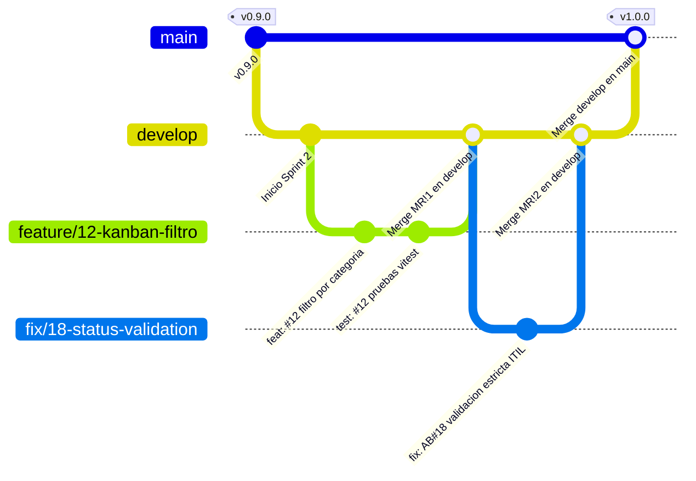

# Estrategia de Branching, Commits y Merge Requests - IT Incident Hub

## 1. Modelo de Ramas: GitFlow Adaptado en GitLab

El desarrollo de **IT Incident Hub** se gestiona centralizadamente en **GitLab**, utilizando un modelo **GitFlow adaptado** gobernado por ramas protegidas y sincronización continua por Mirroring hacia GitHub:



---

## 2. Tipología y Reglas de Ramas

| Nombre de Rama | Tipo | Protección en GitLab | Origen & Destino | Propósito y Ciclo de Vida |
| :--- | :---: | :---: | :--- | :--- |
| `main` | Permanente | **Protegida (Maintainers)** | Fusión desde `develop` | Refleja el código en producción en Render. Todo merge o tag `v*` en esta rama dispara el pipeline de empaquetado y el Deploy Hook hacia Render. |
| `develop` | Permanente | **Protegida (Maintainers)** | Fusión desde `feature/*` o `fix/*` | Rama de integración continua. Contiene los últimos cambios aprobados por el equipo. |
| `feature/<id>-<nombre>` | Temporal | No protegida | Desde `develop` &rarr; Hacia `develop` | Desarrollo de nuevas historias de usuario o capacidades funcionales vinculadas a un Issue (`feature/14-incident-export`). |
| `fix/<id>-<nombre>` | Temporal | No protegida | Desde `develop` &rarr; Hacia `develop` | Corrección de defectos, bugs de pruebas o deuda técnica identificada (`fix/18-status-validation`). |
| `hotfix/<id>-<nombre>` | Temporal | No protegida | Desde `main` &rarr; Hacia `main` y `develop` | Remediación de emergencias críticas (Severidad 1) detectadas directamente en Producción. |

---

## 3. Convención de Commits y Trazabilidad con GitLab Issues

Se implementa la especificación **Conventional Commits 1.0.0**, requiriendo el identificador de tarea de los tableros de GitLab o Azure Boards (`#ID` o `AB#ID`):

### Formato Estándar:
```text
<tipo>(<alcance>): <prefijo-issue> <descripción concisa en imperativo>

[cuerpo explicativo detallando motivación técnica o breaking changes]

Closes #ID / Resolves AB#ID
```

### Tipos Permitidos:
- `feat`: Nueva funcionalidad para usuarios o técnicos (`feat(kanban): #12 añadir filtros dinámicos por estado`).
- `fix`: Corrección de un defecto o fallo de lógica (`fix(backend): AB#18 validar transición de estados ITIL`).
- `docs`: Modificaciones exclusivas a documentación técnica (`docs: #5 actualizar diagrama de sincronización GitLab-GitHub`).
- `refactor`: Cambios de código sin alteración de funcionalidad externa (`refactor(api): #17 implementar DTOs y validación JSR-380`).
- `test`: Creación o mejora de pruebas unitarias/integradas (`test(service): #18 agregar suite de pruebas para BadRequestException`).
- `ci`: Modificaciones en pipelines, scripts o runners (`ci(gitlab): #1 actualizar stages a build_and_package y deploy`).
- `chore`: Tareas auxiliares de configuración o dependencias (`chore(deps): #3 actualizar postgresql jdbc a 42.7.3`).

---

## 4. Flujo de Trabajo y Reglas para Merge Requests (MR) en GitLab

Dado que **GitLab es el repositorio de trabajo primario**, el ciclo de revisión y fusión sigue un protocolo estricto:

1. **Apertura del Merge Request en GitLab:**
   - La rama de trabajo (`feature/*` o `fix/*`) se envía a GitLab.
   - Se crea el Merge Request con destino a `develop` (o a `main` para releases).
2. **Sincronización Automática por Mirroring:**
   - GitLab sincroniza la rama hacia el repositorio espejo en GitHub.
   - En GitHub Actions, se dispara de inmediato el workflow `pr-validation.yml`.
3. **Validación y Notificación de Estado:**
   - GitHub Actions ejecuta:
     - 🔒 Escaneo de detección de archivos `.env` y llaves privadas.
     - 🔍 Linter Frontend (ESLint) y Linter Backend (Checkstyle).
     - 🧪 Pruebas unitarias de Backend (JUnit 5 + Mockito).
   - Mediante la **GitLab Commit Status API**, GitHub Actions reporta el resultado directamente al commit de GitLab:
     - Si todo pasa: Se muestra el **Check Verde (`✔ github-actions/quality-gate`)** en el Merge Request de GitLab.
     - Si algo falla: Se muestra la **X Roja (`❌ github-actions/quality-gate`)**, bloqueando la fusión.
4. **Revisión de Pares (Peer Review):**
   - Mínimo **1 aprobación obligatoria** por un revisor técnico antes del merge.
5. **Fusión y Despliegue:**
   - Se ejecuta la fusión en GitLab utilizando **Merge Commit** o **Squash and Merge**.
   - Tras el merge en `main`, el pipeline de GitLab CI (`.gitlab-ci.yml`) en el `self-hosted-runner` compila, empaqueta el artefacto `.zip` y dispara el Deploy Hook hacia Render.
