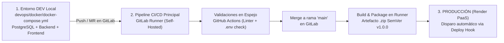

# Estrategia de Release, Gestión de Ambientes y Plan de Rollback - IT Incident Hub

## 1. Topología de Ambientes de Despliegue

La progresión de versiones de **IT Incident Hub** transita de manera segura a través de ambientes claramente diferenciados:



---

## 2. Definición y Reglas por Ambiente

### 1. Entorno de Desarrollo Local (`development`)
- **Infraestructura:** Contenedores orquestados mediante [devops/docker/docker-compose.yml](file:///c:/Users/50254/Documents/Analisis2/ProyectoFinal/ProyectoFinalAnalisis/incident-hub/devops/docker/docker-compose.yml).
- **Propósito:** Desarrollo local de nuevas características, depuración y ejecución de pruebas rápidas de integración.
- **Acceso:** `http://localhost:3000` (Frontend SPA) y `http://localhost:8080` (Backend API).

### 2. Entorno de Producción en la Nube (`production` en Render PaaS)
- **Infraestructura:** Servicios en Render bajo la región de Oregon:
  - Base de Datos Gestionada: `incident-hub-db` (PostgreSQL 15 con SSL obligatorio).
  - Web Service Backend: `incident-hub-backend` (Spring Boot 3 en Docker).
  - Static Site Frontend: `incident-hub-frontend` (React 18 en CDN global).
- **Disparador:** **Automático ante Merge en `main`**. Tras aprobar los stages de `test`, `security` y `build_and_package` en el GitLab Runner autohospedado, el job `deploy:render_production` ejecuta una solicitud HTTP POST hacia el **Deploy Hook** de Render.

---

## 3. Gestión de Versiones con Semantic Versioning (SemVer 2.0.0)

El proyecto adopta formalmente la especificación SemVer:

```text
v1.0.0
 │ │ └── PARCHE: Corrección de defectos y hotfixes retrocompatibles (ej. v1.0.1).
 │ └──── MENOR:  Nuevas funcionalidades compatibles (ej. v1.1.0 - exportación de reportes).
 └────── MAYOR:  Cambios arquitectónicos o rupturas de contratos API (ej. v2.0.0).
```

### Proceso de Lanzamiento de la Release Oficial `v1.0.0`:
1. Asegurar que las validaciones de GitHub Actions reporten Check verde (`state=success`) en GitLab.
2. Completar la revisión por pares (Peer Review) en el Merge Request correspondiente.
3. Fusionar los cambios aprobados hacia la rama `main` en GitLab.
4. Generar el tag semántico firmado:
   ```bash
   git checkout main
   git pull origin main
   git tag -a v1.0.0 -m "Release v1.0.0: IT Incident Hub - Producción Inicial"
   git push origin v1.0.0
   ```
5. El runner autohospedado de GitLab compila el proyecto, genera el paquete `incident-hub-v1.0.0-<commit_sha>.zip` y activa el Deploy Hook en Render.

---

## 4. Procedimiento de Reversión (Rollback)

Si se detecta una degradación de servicio o anomalía crítica en Producción:

### Nivel 1: Rollback Inmediato en Render Dashboard (< 1 minuto)
1. Ingresar al **Dashboard de Render** &rarr; Seleccionar `incident-hub-backend`.
2. Dirigirse a la pestaña **Events**.
3. Localizar el despliegue previo exitoso y estable.
4. Seleccionar la opción **Rollback to this deploy**.
5. Render conmutará el tráfico inmediatamente hacia el contenedor anterior sin tiempos de desconexión.

### Nivel 2: Rollback mediante Reversión de Tag en Git
1. Crear una rama de remediación rápida desde el commit/tag anterior:
   ```bash
   git checkout -b hotfix/revert-release v0.9.0
   ```
2. Realizar un `git revert` del commit defectuoso en `main`.
3. Crear un nuevo tag de parche (ej. `v1.0.1`) y enviarlo a GitLab para activar el pipeline y despliegue limpio.

---

## 5. Checklist para Aprobación de Lanzamientos

- [ ] **1. Validaciones de Espejo:** Check verde (`state=success`) confirmado en GitLab desde GitHub Actions.
- [ ] **2. Pruebas Automatizadas:** 100% de éxito en los tests de backend (`mvn test`) y frontend (`npm test`) en el runner autohospedado.
- [ ] **3. Auditoría de Seguridad:** Ejecución de `npm audit` completada sin vulnerabilidades bloqueantes.
- [ ] **4. Cero Secretos:** Cero archivos `.env` detectados en el repositorio.
- [ ] **5. Empaquetado SemVer:** Generación exitosa del artefacto `.zip` con nombre `v1.0.0` y hash del commit.
- [ ] **6. Deploy Hooks Verificados:** Variables secretas de Render configuradas en GitLab CI/CD Variables.
- [ ] **7. Aprobación Formal:** Firma técnica del DevOps Lead en el Merge Request de GitLab.
