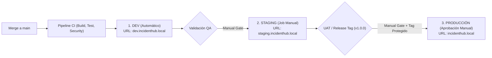

# Estrategia de Release y Gestión de Ambientes - IT Incident Hub

## 1. Topología de Ambientes de Despliegue

El proyecto define una progresión estricta a través de tres entornos gestionados mediante **GitLab Environments**:



---

## 2. Definición y Reglas por Ambiente

### 1. Entorno de Desarrollo (`development`)
- **Propósito:** Integración continua y pruebas rápidas de las funcionalidades fusionadas.
- **Disparador:** **Automático** ante cualquier merge exitoso a `main` tras superar los stages de `build`, `test`, `security` y `package`.
- **Datos:** Semilla inicial con base de datos volátil (`database/02_seed.sql`).
- **Configuración en CI:**
  ```yaml
  deploy_to_dev:
    stage: deploy-dev
    environment:
      name: development
      url: http://dev.incidenthub.local:3000
    only:
      - main
  ```

### 2. Entorno de Homologación / Pre-Producción (`staging`)
- **Propósito:** Pruebas de integración de sistema (SIT), pruebas de carga y validación de aceptación de usuario (UAT).
- **Disparador:** **Manual** (`when: manual`). Debe ser activado explícitamente por el rol **QA Engineer (Mateo Ruiz)** tras certificar la estabilidad en DEV.
- **Configuración en CI:**
  ```yaml
  deploy_to_staging:
    stage: deploy-staging
    environment:
      name: staging
      url: http://staging.incidenthub.local:3000
    when: manual
    only:
      - main
  ```

### 3. Entorno de Producción (`production`)
- **Propósito:** Operación comercial real del sistema.
- **Disparador:** **Manual y condicionado a Tags protegidos** (`only: tags` + `when: manual`).
- **Seguridad:** Requiere perfil **Maintainer** (Carlos Gómez) para desbloquear el job manual.
- **Configuración en CI:**
  ```yaml
  deploy_to_production:
    stage: deploy-prod
    environment:
      name: production
      url: http://incidenthub.local:3000
    when: manual
    only:
      - tags
  ```

---

## 3. Flujo para la Publicación de una Release Oficial (`v1.0.0`)

Cuando el código en `main` ha sido homologado en Staging y se cuenta con el Changelog actualizado:

1. **Creación del Tag Git firmado localmente:**
   ```bash
   git checkout main
   git pull origin main
   git tag -a v1.0.0 -m "Release v1.0.0: IT Incident Hub producción inicial"
   git push origin v1.0.0
   ```
2. **Ejecución del Pipeline del Tag:**
   - GitLab detecta el tag `v1.0.0` y lanza el pipeline completo.
   - En el stage `publish`, se generan y firman los artefactos binarios.
3. **Aprobación Manual en GitLab:**
   - El Lead DevOps navega a **CI/CD &rarr; Pipelines** en la interfaz de GitLab.
   - Localiza el job `deploy_to_production` en el stage `deploy-prod`.
   - Hace clic en el botón de reproducción (▶️ **Play**) para autorizar el despliegue a producción.
4. **Publicación en GitLab Releases:**
   - Navegar a **Deploy &rarr; Releases &rarr; New release**.
   - Seleccionar el tag `v1.0.0`.
   - Copiar la sección correspondiente de [CHANGELOG.md](file:///c:/Users/50254/Documents/Analisis2/ProyectoFinal/ProyectoFinalAnalisis/incident-hub/CHANGELOG.md).
   - Enlazar los artefactos binarios generados en el stage `publish`.

---

## 4. Procedimiento de Reversión (Rollback)

Si se detecta un incidente crítico de severidad 1 en Producción:
1. **Reversión Instantánea en GitLab:**
   - Ir a **Operate &rarr; Environments &rarr; production**.
   - En el historial de despliegues, hacer clic en el botón **Rollback** en la versión inmediatamente anterior estable (por ejemplo, `v0.2.0`).
2. **Reversión mediante Contenedores Locales:**
   ```bash
   # Desplegar la imagen de la versión anterior
   docker compose down
   export IMAGE_TAG="v0.2.0"
   docker compose up -d
   ```
3. **Flujo de Hotfix en Git:**
   - Crear rama `fix/<id>-hotfix` desde el tag de producción.
   - Corregir el bug, pasar el pipeline, y generar tag de parche `v1.0.1`.
