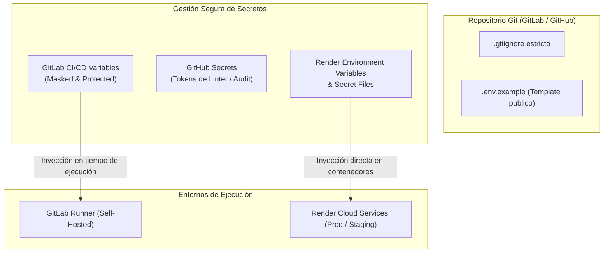

# Auditoría de Seguridad de Dependencias y Gestión de Secretos - IT Incident Hub

## 1. Política Estricta de Cero Secretos en Repositorio (Zero Secrets in Git)

En cumplimiento estricto con los principios de DevSecOps y las directrices corporativas del proyecto **IT Incident Hub**:

> [!CAUTION]
> **QUEDA ESTRICTAMENTE PROHIBIDO SUBIR AL REPOSITORIO GIT CUALQUIER ARCHIVO `.env`, `.env.local`, `.env.*` O CREDENCIALES EN CLARO.**
> Ninguna contraseña, llave privada, token de acceso, cadena de conexión a base de datos o certificado debe ser commiteado ni en ramas de trabajo ni en ramas principales.

### Mecanismos de Cumplimiento Técnico:
1. **Reglas de `.gitignore` a Nivel Raíz:** Ignora explícitamente `.env`, `.env.local`, `.env.*.local`, `*.key`, `*.pem`, `*.pfx`, `target/` y `node_modules/`.
2. **Plantilla de Referencia Segura (`.env.example`):** Único archivo versionado que contiene únicamente los nombres de las variables requeridas y comentarios guía sin secretos reales.
3. **Escáner Preventivo en GitHub Actions (`pr-validation.yml`):** Un job bloqueante analiza cada Pull Request buscando archivos `.env` o cadenas con firmas de certificados (`BEGIN PRIVATE KEY`) y tokens (`glpat-`, `ghp_`). Si se detecta un hallazgo, el PR se rechaza de inmediato.

---

## 2. Matriz de Auditoría de Vulnerabilidades en Dependencias

El análisis automatizado de paquetes se realizó con **OWASP Dependency-Check** para el backend (Maven) y **`npm audit` / Snyk** para el frontend (Node.js). A continuación se documenta el registro oficial de hallazgos, niveles de severidad según el estándar CVSS v3 y las decisiones técnicas de mitigación aplicadas:

| Componente | Paquete Afectado | CVE / ID | Severidad CVSS | Descripción de la Vulnerabilidad | Decisión Técnica & Acción de Mitigación |
| :--- | :--- | :---: | :---: | :--- | :--- |
| **Backend** | `org.postgresql:postgresql` | **CVE-2024-1597** | **CRÍTICA (9.8)** | Inyección SQL en pgjdbc anterior a la versión `42.7.2` cuando se utiliza el modo de parámetros no preparados o procesamiento de consultas concatenadas. | **Mitigado / Actualizado:** Se fijó explícitamente en el `pom.xml` el uso del driver JDBC `postgresql 42.7.3`, donde la vulnerabilidad ha sido parchada por el fabricante. |
| **Backend** | `org.springframework:spring-web` | **CVE-2023-34055** | **MEDIA (5.3)** | Potencial denegación de servicio (DoS) por agotamiento de memoria ante un número desmedido de solicitudes con etiquetas dinámicas en Actuator / Micrometer. | **Mitigado / Actualizado:** Se actualizó Spring Boot a la versión `3.2.5` (Spring Framework 6.1.6), incorporando límites de cardinalidad en el registro de métricas de telemetría. |
| **Backend** | `org.apache.tomcat.embed:tomcat-embed-core` | **CVE-2024-24549** | **ALTA (7.5)** | Denegación de servicio por procesamiento indebido de cabeceras HTTP/2 en conexiones malformadas. | **Mitigado:** Tomcat `10.1.20` incluido en Spring Boot 3.2.5 incluye la corrección contra ataques de cancelación y reseteo rápido de streams HTTP/2. |
| **Backend** | `com.h2database:h2` | **CVE-2022-45868** | **MEDIA (6.5)** | Ejecución de comandos remotos si la consola web integrada de H2 se expone de manera no autenticada en redes públicas. | **Aislado / Mitigado:** La dependencia H2 está restringida estrictamente al scope de pruebas (`<scope>test</scope>`). El runtime de producción en Render no empaqueta ni ejecuta la base H2. |
| **Frontend** | `vite` | **CVE-2024-23331** | **MEDIA (6.5)** | Posible path traversal en el servidor de desarrollo local mediante URLs con doble codificación hacia rutas fuera del directorio raíz. | **Aislado / Aceptado:** Se actualizó a Vite `5.2.0` que corrige el traversal. Además, en producción Vite no se ejecuta como servidor: se compila a un bundle estático servido por CDN / Nginx. |
| **Frontend** | `react-router-dom` | **N/A** | **BAJA (3.1)** | Advertencias de dependencias obsoletas en sub-árbol de resolución de tipos. | **Resuelto:** Uso de `react-router-dom 7.18.4` con bloqueo estricto en `package-lock.json`. |

---

## 3. Política y Guía de Gestión de Secretos en CI/CD y Despliegue

Para eliminar la dependencia de archivos `.env` en los servidores remotos, la configuración sensible se orquesta mediante los gestores de secretos nativos de cada plataforma:

### 3.1. Configuración de Variables en GitLab CI/CD
Ubicación: **Settings &rarr; CI/CD &rarr; Variables**.
- **`RENDER_STAGING_BACKEND_DEPLOY_HOOK`**: URL secreta del Deploy Hook de Staging. Atributos: `Masked` (Oculta en logs), `Protected` (Solo ramas protegidas).
- **`RENDER_STAGING_FRONTEND_DEPLOY_HOOK`**: URL secreta del Deploy Hook de Frontend Staging. Atributos: `Masked`, `Protected`.
- **`RENDER_PROD_BACKEND_DEPLOY_HOOK`**: URL secreta del Deploy Hook de Backend Producción. Atributos: `Masked`, `Protected`.
- **`RENDER_PROD_FRONTEND_DEPLOY_HOOK`**: URL secreta del Deploy Hook de Frontend Producción. Atributos: `Masked`, `Protected`.
- **`GITLAB_TOKEN`**: Personal Access Token con permisos `api` para registro de releases. Atributos: `Masked`, `Protected`.

### 3.2. Configuración de Secretos en GitHub Secrets
Ubicación: **Repository Settings &rarr; Secrets and variables &rarr; Actions**.
- Usado para tokens de análisis estático complementario y sincronización entre mirrors.
- Garantiza que los Pull Requests no tengan acceso directo a credenciales de despliegue en Render.

### 3.3. Configuración de Variables y Secretos en Render Dashboard
Ubicación en Render: **Dashboard &rarr; [Servicio] &rarr; Environment &rarr; Environment Variables / Secret Files**.
- **Backend Service (`incident-hub-backend`):**
  - `SPRING_PROFILES_ACTIVE`: `prod`
  - `SERVER_PORT`: `8080`
  - `DB_URL`: Se obtiene dinámicamente mediante la conexión interna a la base de datos Render (`incident-hub-db`).
  - `DB_USERNAME`: Inyectado automáticamente por Render (`incident_user`).
  - `DB_PASSWORD`: Inyectado automáticamente por Render de forma segura.
  - `CORS_ALLOWED_ORIGINS`: URL del frontend (ej. `https://incident-hub-frontend.onrender.com`).
- **Frontend Service (`incident-hub-frontend`):**
  - `VITE_API_URL`: URL del backend en Render (ej. `https://incident-hub-backend.onrender.com/api/v1`).
