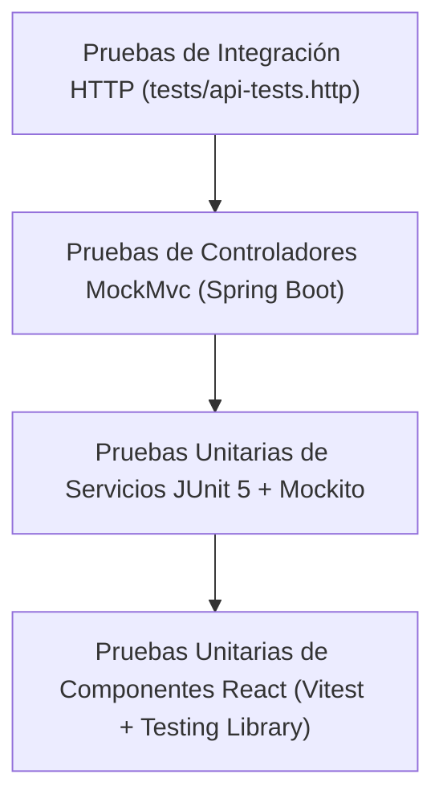

# Estrategia de Pruebas y Aseguramiento de Calidad - IT Incident Hub

## 1. Niveles de Prueba Implementados



---

## 2. Comandos para Ejecución de Pruebas

### Pruebas de Backend (JUnit 5 + Mockito):
```bash
cd backend
# Ejecutar todas las pruebas unitarias
mvn test

# Ejecutar una clase de prueba específica
mvn test -Dtest=IncidentServiceTest

# Validar linter Checkstyle sin correr pruebas
mvn checkstyle:check
```

### Pruebas de Frontend (Vitest):
```bash
cd frontend
# Ejecutar todas las pruebas unitarias
npm run test

# Modo observador interactivo (watch mode)
npm run test:watch

# Validar linter ESLint
npm run lint
```

### Pruebas de API REST:
Abre el archivo [api-tests.http](file:///c:/Users/50254/Documents/Analisis2/ProyectoFinal/ProyectoFinalAnalisis/incident-hub/tests/api-tests.http) con la extensión *REST Client* en VS Code o en IntelliJ IDEA para ejecutar peticiones directamente contra el servidor en ejecución.
